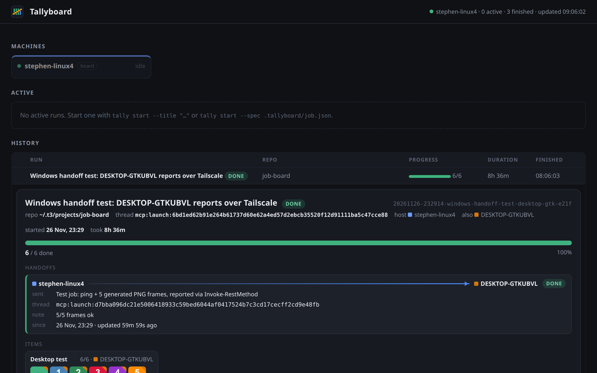
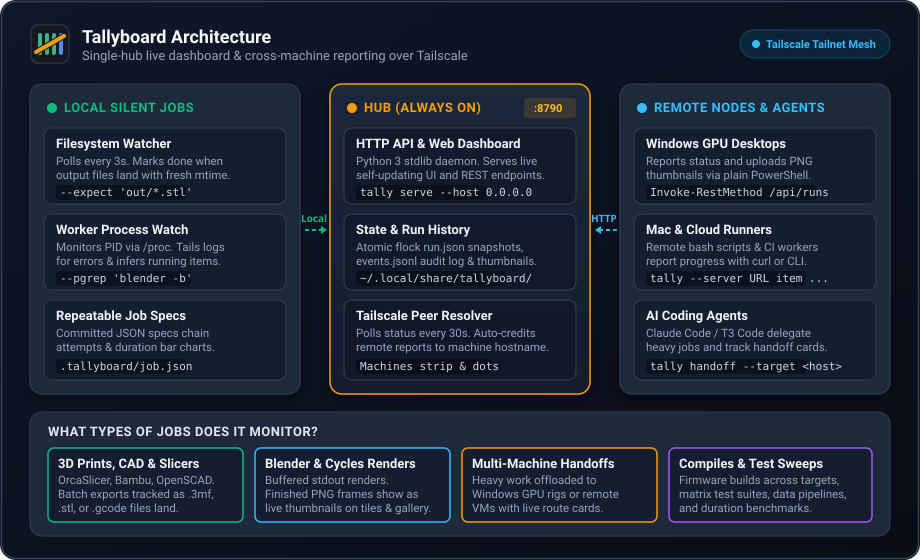

<p align="center">
  
</p>

<h1 align="center">Tallyboard</h1>

<p align="center">
  A tiny, zero-dependency live dashboard for long-running agent work: batch builds, renders, file-watched outputs, and cross-machine handoffs over Tailscale.
</p>

<p align="center">
  
</p>

---

**Tallyboard** gives every repo, shell script, and AI coding agent on your network one shared live board. It is written in **Python 3 stdlib only**, with no build step, no database, and no external packages: one CLI (`tally`), one HTTP server, and one single-file live web page.

## Highlights

- **Shared board, any repo:** One state directory (`~/.local/share/tallyboard/runs/`) stores every run as `run.json`, an append-only `events.jsonl`, and uploaded thumbnails. Active runs appear first; completed runs stay in searchable history.
- **File & PID watching for silent tools:** Tools like Blender buffer stdout. Declare expected outputs (paths or globs) and worker PIDs/`pgrep` regexes, and Tallyboard infers progress every 3 seconds as fresh files land.
- **Repeatable job specs:** Commit a `.tallyboard/<name>.json` file in any repo. Re-running it chains attempts (`#1`, `#2`, …) so you can compare durations side by side.
- **Automatic multi-machine & Tailscale tracking:** A **Machines** strip shows what is running on every host, with live online/offline status from `tailscale status --json`. Any new machine added to your tailnet is discovered automatically — remote HTTP reports are credited to the sending machine by IP with zero configuration.
- **Works from Windows, Linux, and macOS:** Remote workers can report via `tally --server URL`, `curl`, or a one-line PowerShell `Invoke-RestMethod` — including raw PNG uploads that render as thumbnails on the board.
- **Agent-ready:** Includes a Claude Code skill template (`skill/SKILL.md`) and reads `$T3CODE_THREAD_ID` / `$CLAUDE_CODE_SESSION_ID` automatically.

## Quick Start

```bash
git clone https://github.com/stephenwil/tallyboard.git
cd tallyboard
./install.sh
```

`install.sh` puts `tally` (and `tallyboard`) in `~/.local/bin/`, installs the Claude Code skill with your auto-detected board URL, and enables the `tallyboard.service` systemd user unit on port `8790` (override with `TALLYBOARD_PORT`).

On macOS or systems without `systemd --user`:

```bash
./bin/tally serve --host 0.0.0.0 --port 8790
```

Print your board's URL (automatically uses Tailscale MagicDNS when available):

```bash
tally url
```

### Accessing the Dashboard

Open any of these in your browser depending on where you are:

| Where you are | URL | Notes |
| :--- | :--- | :--- |
| **This machine** | `http://localhost:8790` | Or `http://127.0.0.1:8790` |
| **Local LAN** | `http://<hostname>.local:8790` | Multicast DNS (mDNS / Bonjour) |
| **Any Tailscale device (Short name)** | `http://<hostname>:8790` | Tailscale MagicDNS search domain |
| **Any Tailscale device (Full FQDN)** | `http://<hostname>.<tailnet>.ts.net:8790` | Always resolves across your tailnet |

## Where to Host Tallyboard (Single Hub Architecture)

Tallyboard is designed around a **single hub**: one machine on your network or tailnet runs `tally serve` and stores the job history (`~/.local/share/tallyboard/`). All other machines report into it over HTTP.

Preferably, run it on a machine that is **always on** (such as your primary workstation with systemd linger enabled, a home server, or a VPS on Tailscale). When choosing your host machine, consider the file-watching tradeoff:

- **Hosting on your main workstation / build machine:** Recommended if you run heavy batch builds or renders locally (e.g. Blender, compilers, slicers) where progress is inferred from files appearing on disk and local worker PIDs. Remote machines (such as GPU nodes or cloud agents) report into it over Tailscale.
- **Hosting on a dedicated always-on server / VPS / Pi:** Keeps the dashboard accessible 24/7 even when your workstation sleeps. Keep in mind that local file and PID watching only inspects the filesystem of the host running `tally serve`. Jobs running on other machines report their progress via HTTP (`tally --server URL`, `curl`, or PowerShell `Invoke-RestMethod`) rather than background disk polling.

Moving the server to another machine at any time is simple: run `./install.sh` on the new host and copy over `~/.local/share/tallyboard/`.

## Architecture & Workflow

<p align="center">
  <a href="assets/architecture.svg">
    
  </a>
</p>

### What Types of Jobs Does It Monitor?

Tallyboard is designed for any multi-step, batch, or long-running work where you don't want an agent or user sitting in a loop running `ls` or `pgrep`:

1. **3D Printing, Slicing & CAD Asset Pipelines**
   - **Examples:** Batch slicing 50 plates in OrcaSlicer / BambuStudio, FreeCAD/OpenSCAD parametric exports, STEP/STL generation.
   - **How it monitors:** Each `.3mf`, `.stl`, or `.gcode` file landing on disk automatically ticks its tile over to `done`.
2. **Heavy 3D Renders & Visual Asset Sweeps**
   - **Examples:** Blender Cycles CPU/GPU renders, turntables, contact sheets, and sprite sheet generation.
   - **How it monitors:** Blender buffers stdout, so progress is inferred from completed `.png`/`.exr` files. Rendered images uploaded or written to disk display as live thumbnails on tiles and in the gallery.
3. **Cross-Machine AI Agent Handoffs (`delegate_task`)**
   - **Examples:** Offloading heavy render/build work from a Linux dev machine to a Windows desktop with an RTX GPU or a remote Mac runner.
   - **How it monitors:** Handoff cards display the link arrow (`workstation → GPU-NODE`), child thread links, and live progress bars for the items assigned to the target host.
4. **Long-Running Compiles & Matrix Test Suites**
   - **Examples:** Firmware compilation across targets, matrix test suites, data transformations, and benchmark passes.
   - **How it monitors:** Wrapped via `tally exec <run> <item> -- <cmd>` or repeatable `.tallyboard/<name>.json` specs with `tally run last -j 4`.
5. **Repeatable Regression & Duration Benchmarks**
   - **Examples:** Nightly exports or pipeline optimizations where you want to know if changes made a batch faster or slower.
   - **How it monitors:** Repeat runs of the same spec `name` link attempts (`#1`, `#2`, …) and render side-by-side duration bars.

## 30-Second Example

```bash
# Start a run with 3 items
RUN=$(tally start --title "Render hero shots" --item shot-1 --item shot-2 --item shot-3 --group Heroes)

# Update progress (or wrap a command with `tally exec`)
tally item $RUN shot-1 running
tally item $RUN shot-1 done -m "41 s"
tally exec $RUN shot-2 -- ./render.sh shot-2

# Hand off an item to another machine on your tailnet
H=$(tally handoff $RUN --target gpu-node --what "Cycles render shot-3")
tally item $RUN shot-3 queued --host gpu-node
```

On the remote Windows machine (PowerShell):

```powershell
$B='http://workstation.your-tailnet.ts.net:8790'; $R='<run-id>'
Invoke-RestMethod -Method Post "$B/api/runs/$R/item" -ContentType 'application/json' -Body (@{id='shot-3';status='done';note='18 s'}|ConvertTo-Json)
Invoke-RestMethod -Method Post "$B/api/runs/$R/upload?item=shot-3&name=shot-3.png" -InFile .\shot-3.png -ContentType 'image/png'
```

## Documentation

- **[How-To Manual](docs/MANUAL.md)** — complete guide covering installation, CLI commands, file & PID watching, job specs, multi-machine Tailscale workflows, AI agent integration, security, and backups.
- **[Example spec](examples/batch-render.json)** — repeatable batch render spec with `item_sources`, `vars`, and worker watching.
- **[Claude Code skill](skill/SKILL.md)** — drop-in skill template installed automatically by `install.sh`.

## Tests

```bash
python3 -m unittest -v
```

## License

[MIT](LICENSE)
