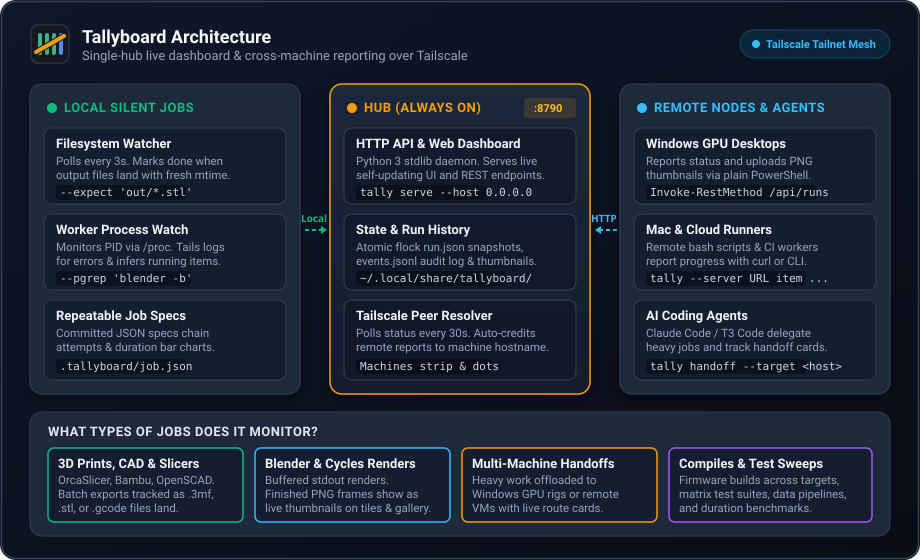

# Tallyboard How-To Manual

This manual covers everything you need to run **Tallyboard**, track local and remote jobs across your Tailscale network, write repeatable specs, and wire it into AI coding agents.

---

## Table of Contents

1. [Installation & Service Management](#1-installation--service-management)
2. [Core Concepts & Architecture](#2-core-concepts--architecture)
   - [Architecture Diagram](#architecture-diagram)
   - [What Types of Jobs Does It Monitor?](#what-types-of-jobs-does-it-monitor)
3. [Tracking Jobs from the CLI](#3-tracking-jobs-from-the-cli)
4. [Watching Silent Tools (Files, Globs & PIDs)](#4-watching-silent-tools-files-globs--pids)
5. [Repeatable Job Specs](#5-repeatable-job-specs)
6. [Cross-Machine & Tailscale Monitoring](#6-cross-machine--tailscale-monitoring)
7. [Using Tallyboard with AI Coding Agents](#7-using-tallyboard-with-ai-coding-agents)
8. [HTTP API Reference](#8-http-api-reference)
9. [History, Persistence, Security & Troubleshooting](#9-history-persistence-security--troubleshooting)

---

## 1. Installation & Service Management

Tallyboard requires only **Python 3.9+** (standard library only, no `pip install`).

### Linux (with `systemd --user`)

```bash
git clone https://github.com/stephenwil/tallyboard.git
cd tallyboard
./install.sh
```

What `install.sh` does:
- Symlinks `tally` and `tallyboard` into `~/.local/bin/`.
- Installs the Claude Code skill into `~/.claude/skills/tallyboard/SKILL.md` with your board's auto-detected URL.
- Installs and starts `~/.config/systemd/user/tallyboard.service` listening on `0.0.0.0:8790`.

To make the user service keep running after you log out and start automatically on reboot:

```bash
loginctl enable-linger "$USER"
```

Useful service commands:

```bash
systemctl --user status tallyboard
systemctl --user restart tallyboard
journalctl --user -u tallyboard -f
```

### Changing the Port

```bash
TALLYBOARD_PORT=9123 ./install.sh
```

### macOS or Manual Run (no systemd)

```bash
./bin/tally serve --host 0.0.0.0 --port 8790
```

You can inspect the detected board URL at any time with:

```bash
tally url
```

If Tailscale is running on the server host, `tally url` automatically uses your Tailscale MagicDNS name (for example `http://workstation.tail1234.ts.net:8790/`). Otherwise it uses `http://<hostname>:8790/`. You can override this with `TALLYBOARD_URL`.

### Choosing Where to Host Tallyboard (Always-On Hub vs Workstation)

Tallyboard operates on a **single hub** model: one machine runs `tally serve` and stores history in `~/.local/share/tallyboard/runs/`. All other machines and threads report into it.

Preferably, run it on a machine that is **always on**. When deciding which machine should be the host:

1. **Main Workstation / Dev Machine (e.g. Linux workstation):**
   - **Advantage:** Enables automatic local file-watching (`--expect` / `output`) and worker PID/log tailing (`--pid` / `--pgrep`) for silent batch jobs like Blender, slicers, or compiler sweeps that run on that machine.
   - Remote machines (e.g. Windows GPU nodes, laptops, cloud runners) report to it over Tailscale.
   - Ensure systemd linger is enabled (`loginctl enable-linger "$USER"`) so the user service runs continuously.

2. **Dedicated Server / VPS / Raspberry Pi:**
   - **Advantage:** Stays accessible 24/7 regardless of whether your primary laptop or workstation is asleep or rebooting.
   - **Tradeoff:** Background file-watching and `/proc` PID watching only inspect the filesystem and process table of the machine running `tally serve`. Jobs running on your other machines must report explicitly via HTTP (`tally --server URL`, `curl`, or PowerShell `Invoke-RestMethod`) rather than relying on the server's disk poller.

**Migrating to a new host:** Simply run `./install.sh` on the new machine and copy over `~/.local/share/tallyboard/`.

---

## 2. Core Concepts & Architecture

### Core Concepts

| Concept | What it represents |
|---|---|
| **Run** | One execution of a job (`running`, `done`, `failed`, or `cancelled`). Has a title, repo, thread, originating host, timestamps, items, workers, and handoffs. |
| **Item** | A discrete unit of work inside a run: `queued → running → done / failed / skipped`. Can belong to a `group` (rendered as its own tile grid), carry a short `label`, `note`, `host`, watched `output`, and optional `cmd`. |
| **Worker** | A background process (tracked by PID or `pgrep` regex) on the board's host. Shows status (`running`, `exited`, `failed`), uptime, and the tail of its log file. |
| **Handoff** | Work delegated to another machine or agent thread: `from → target`, what was sent, child thread ID/link, and status (`sent`, `running`, `done`, `failed`). |
| **Machine** | Every run, item, worker, and handoff has a host. The **Machines** strip at the top of the page aggregates active work per host with live Tailscale online/offline dots. |
| **Spec** | A committed JSON file (e.g. `.tallyboard/render.json`) describing a repeatable job. Runs created from the same spec `name` are linked (`attempt` #1, #2, …) so duration history is charted automatically. |

### Architecture Diagram

<p align="center">
  <a href="../assets/architecture.svg">
    
  </a>
</p>

### What Types of Jobs Does It Monitor?

Tallyboard is built for any batch, multi-step, or background workload:

1. **3D Printing, Slicing & CAD Asset Pipelines**
   - **Examples:** Batch slicing 50 plates in OrcaSlicer / BambuStudio, OpenSCAD parametric exports, FreeCAD STEP/STL exports.
   - **How it monitors:** As each `.3mf`, `.stl`, or `.gcode` lands in the watched output directory, its tile marks `done` in real time.
2. **Heavy 3D Renders & Visual Asset Sweeps**
   - **Examples:** Blender Cycles CPU/GPU renders, turntables, contact sheets, and sprite sheet generation.
   - **How it monitors:** Blender buffers stdout, so progress is inferred from completed `.png`/`.exr` files. Rendered images uploaded or written to disk display as live thumbnails on tiles and in the gallery.
3. **Cross-Machine AI Agent Handoffs (`delegate_task`)**
   - **Examples:** Offloading heavy render/build work from a Linux dev machine to a Windows desktop with an RTX GPU or a remote Mac runner.
   - **How it monitors:** Handoff cards display the link arrow (`workstation → GPU-NODE`), child thread links, and live progress bars for the items assigned to the target host.
4. **Long-Running Compiles & Matrix Test Suites**
   - **Examples:** Firmware compilation across targets, matrix test suites, data transformations, and benchmark passes.
   - **How it monitors:** Wrapped via `tally exec <run> <item> -- <cmd>` or repeatable `.tallyboard/<name>.json` specs with `tally run last -j 4`.
5. **Repeatable Regression & Duration Benchmarks**
   - **Examples:** Nightly exports or pipeline optimizations where you want to know if changes made a batch faster or slower.
   - **How it monitors:** Repeat runs of the same spec `name` link attempts (`#1`, `#2`, …) and render side-by-side duration bars.

---

## 3. Tracking Jobs from the CLI

### Ad-hoc Runs

`tally start` prints the new run ID to stdout (and a summary + direct link to stderr), making it easy to capture in scripts:

```bash
RUN=$(tally start --title "Export assets" --item mesh-a --item mesh-b --group Meshes)
```

Update items individually or in batches:

```bash
tally item $RUN mesh-a running
tally item $RUN mesh-a done -m "14 s"
tally item $RUN mesh-b failed -m "non-manifold geometry"
```

Attach log notes at any time (`note` is an alias for `log`):

```bash
tally log $RUN "Switched to 128 samples"
tally log $RUN "Retrying mesh-b with decimate modifier" --level warn
```

### Wrapping Commands with `tally exec`

`tally exec` marks an item `running`, executes the command, and marks it `done` (exit 0) or `failed` (non-zero) with elapsed time:

```bash
tally exec $RUN mesh-b -- blender -b scene.blend -P export.py
```

### Using `last` Instead of Copying Run IDs

Almost every subcommand accepts `last` as the `RUN` argument. It picks the newest active run, preferring the current agent thread (`$T3CODE_THREAD_ID` / `$CLAUDE_CODE_SESSION_ID`):

```bash
tally item last mesh-b done
tally log last "All exports verified"
tally finish last
```

### Inspecting Runs in the Terminal

```bash
tally status             # list recent runs
tally status last        # detailed view of the latest active run
tally status last -v     # include completed items
tally status last --json # raw JSON
tally machines           # per-machine summary of active work
```

### Auto-Finish vs Manual Finish

By default, a run automatically marks itself `done` as soon as all of its items are `done` or `skipped`. Pass `--no-auto-finish` to `tally start` if you plan to add more items later, then close it manually:

```bash
tally finish $RUN                     # marks done
tally finish $RUN --status failed -m "aborted on step 4"
tally finish $RUN --status cancelled
```

---

## 4. Watching Silent Tools (Files, Globs & PIDs)

Many batch tools (Blender, slicers, video encoders) buffer stdout and cannot call back to an API. Tallyboard's background watcher polls every active run every **3 seconds**.

### Watching Output Files

Declare expected outputs with `--expect` (or `"output"` in a spec), relative to the run's `base_dir`:

```bash
RUN=$(tally start --title "Slice models" \
  --expect 'out/part_01.gcode' \
  --expect 'out/part_02.gcode' \
  --expect 'renders/turntable_*.png')
```

How completion is decided:
- An item is marked `done` when at least `min_files` (default `1`) matching files exist **and their modification time (`mtime`) is newer than the run's `started_at`**.
- Existing files from *before* the run are shown with an amber outline ("old output from before this run") and do **not** falsely mark the item done until overwritten.
- Image outputs (`.png`, `.jpg`, `.jpeg`, `.webp`, `.gif`) automatically appear as thumbnails on the item tile and in the **Images** gallery.

### Watching Worker Processes & Logs

Attach local workers by PID or `pgrep` regex:

```bash
tally worker $RUN "blender-1" --pid 48210 --log /tmp/blender1.log --groups "Batch 1" "Batch 2"
# or find by command line (also re-detects restarted workers):
tally worker $RUN "blender-1" --pgrep "blender -b .*render\.py" --log /tmp/blender1.log
```

- `/proc` start ticks protect against PID reuse.
- The last 3 non-empty lines of `--log` are displayed on the worker card.
- If a worker exits and its log matches `Traceback (most recent call last)`, `Error: script failed`, or `^Error:` (customizable via `"fail_pattern"` in a spec), the worker is marked `failed` rather than `exited`.
- When a live worker specifies `--groups`, Tallyboard marks the first `queued` item in those groups as `running (inferred)` — ideal for sequential batch scripts.

### Registering a Job That Already Started

If your workers are already halfway through when you register the run, backdate `started_at` so files already written since the workers started count as `done`:

```bash
# Backdate to the earliest matching live worker's start time:
tally start --spec .tallyboard/build.json --since-workers

# Or backdate explicitly (ISO 8601, epoch seconds, `ps -o lstart`, or pid:N):
tally start --spec .tallyboard/build.json --since "pid:48210"
tally start --spec .tallyboard/build.json --since "2026-11-27T08:00:00"
```

### Watching Without the Server

If you aren't running `tally serve`, you can run the watcher directly in your terminal:

```bash
tally watch $RUN           # polls every 3s until the run finishes
tally watch $RUN --once    # single pass
```

---

## 5. Repeatable Job Specs

Commit a JSON spec file in your repository — either `tallyboard.json` at the repo root or `.tallyboard/<name>.json` (`.jobboard/<name>.json` is also supported).

### Full Spec Example

See [`examples/batch-render.json`](../examples/batch-render.json):

```json
{
  "name": "batch-render",
  "title": "Batch Cycles renders ({batch})",
  "base_dir": "..",
  "vars": {
    "batch": "Batch 1"
  },
  "auto_finish": true,
  "item_sources": [
    {
      "glob": "scenes/{batch}/*.blend",
      "id": "{parent}/{stem}",
      "group": "{parent}",
      "label": "{stem}",
      "label_sub": { "_final$": "" },
      "output": "renders/{parent}/{stem}.png",
      "cmd": "blender -b '{path}' -o 'renders/{parent}/{stem}_' -f 1"
    }
  ],
  "items": [
    {
      "id": "contact-sheet",
      "group": "Summary",
      "label": "Sheet",
      "output": "renders/{batch}/contact_sheet.png"
    }
  ],
  "workers": [
    {
      "name": "blender",
      "pgrep": "blender -b .*scenes/",
      "groups": ["{batch}"],
      "log": "/tmp/batch-render.log"
    }
  ]
}
```

### Spec Rules

- **`name`**: Links repeat runs together (`attempt` #1, #2, …). Defaults to the spec filename without `.json`.
- **`base_dir`**: Relative to the spec file. When omitted, a spec inside `.tallyboard/` defaults to the parent folder (the repo root); otherwise it defaults to the spec's own folder.
- **`vars`**: Key/value placeholders (`{key}`) substituted anywhere in the spec. Override at launch with `--var key=value` (repeatable).
- **`item_sources`**: Expands matching files once at `tally start` using natural sorting (`2` before `10`). Available placeholders per matched file:
  - `{path}` — path relative to `base_dir`
  - `{name}` — filename with extension
  - `{stem}` — filename without extension
  - `{ext}` — extension (including `.`)
  - `{parent}` — immediate parent directory name
  - `{dir}` — directory relative to `base_dir`
- **`label_sub`**: Optional `{regex: replacement}` map to tidy up tile labels.

### Running & Repeating a Spec

```bash
# Start a fresh run from a spec (default vars):
tally start --spec .tallyboard/batch-render.json

# Override a variable:
tally start --spec .tallyboard/batch-render.json --var batch="Batch 2"

# Optional: execute all queued/failed per-item "cmd" entries with 4 parallel workers:
tally run last -j 4

# Re-run only failed items (default) or everything (--all):
tally run last --all -j 4
```

Every time you start a spec with the same `name`, Tallyboard links it to previous runs and renders a compact duration bar chart inside the run card so you can spot regressions or speedups immediately.

---

## 6. Cross-Machine & Tailscale Monitoring

Tallyboard is built to watch jobs spread across multiple machines — for example, a Linux dev server that hands off GPU renders to a Windows desktop, a Mac laptop, or a cloud build box.

### How Tailscale Auto-Discovery Works

- Every 30 seconds, the Tallyboard server runs `tailscale status --json` and refreshes its in-memory peer table (`TailscaleIPs`, `HostName`, `DNSName`, and `Online` state).
- **Adding a new machine to your tailnet requires zero Tallyboard configuration and no restart.** Within 30 seconds of joining your tailnet:
  - Any HTTP POST from the new machine is automatically mapped from its Tailscale IP to its hostname (no `"host"` field needed in the JSON body).
  - Its online/offline indicator dot appears in the **Machines** strip whenever it has active runs, workers, or open handoffs.
  - Different spellings (such as MagicDNS name vs OS hostname, or `.ts.net` FQDN) are automatically normalized into one machine card.
- Idle devices on your tailnet (phones, TVs, etc.) stay off the **Machines** strip until they participate in an active run.
- If Tailscale is not installed, Tallyboard still works over LAN/HTTP and falls back to reverse DNS (or explicit `"host"` fields in POST payloads).

### Step-by-Step Cross-Machine Handoff

1. **On the board host**, create the run, pre-assign remote items with `--host`, and record the handoff:

   ```bash
   RUN=$(tally start --title "Cycles renders" --item frame-1 --item frame-2 --group Renders)
   tally item $RUN frame-1 frame-2 queued --host GPU-NODE
   H=$(tally handoff $RUN --target GPU-NODE --what "Cycles GPU renders (2 frames)")
   ```

2. **On a remote Linux or macOS machine**, use either the `tally` CLI pointed at `--server` or plain `curl`:

   ```bash
   export TALLYBOARD_SERVER="http://workstation.your-tailnet.ts.net:8790"

   tally item $RUN frame-1 running
   # ... do work ...
   tally item $RUN frame-1 done -m "22 s"

   # Or with curl (no install required on the remote machine):
   curl -s -XPOST -H 'Content-Type: application/json' \
     -d '{"id":"frame-1","status":"done","note":"22 s"}' \
     "$TALLYBOARD_SERVER/api/runs/$RUN/item"
   ```

3. **On a remote Windows machine (PowerShell 5.1+ / PowerShell 7)** — zero dependencies required:

   ```powershell
   $B = 'http://workstation.your-tailnet.ts.net:8790'
   $R = '<run-id>'

   # Check connectivity
   Invoke-RestMethod "$B/api/health"

   # Mark handoff running
   Invoke-RestMethod -Method Post "$B/api/runs/$R/handoff" `
     -ContentType 'application/json' `
     -Body (@{handoff_id='h1'; status='running'; note='started on GPU'} | ConvertTo-Json)

   # Mark item running -> upload thumbnail -> mark item done
   Invoke-RestMethod -Method Post "$B/api/runs/$R/item" `
     -ContentType 'application/json' `
     -Body (@{id='frame-1'; status='running'} | ConvertTo-Json)

   Invoke-RestMethod -Method Post "$B/api/runs/$R/upload?item=$([uri]::EscapeDataString('frame-1'))&name=frame-1.png" `
     -InFile .\frame-1.png -ContentType 'image/png'

   Invoke-RestMethod -Method Post "$B/api/runs/$R/item" `
     -ContentType 'application/json' `
     -Body (@{id='frame-1'; status='done'; note='22 s'} | ConvertTo-Json)

   # Mark handoff done
   Invoke-RestMethod -Method Post "$B/api/runs/$R/handoff" `
     -ContentType 'application/json' `
     -Body (@{handoff_id='h1'; status='done'; note='2/2 frames ok'} | ConvertTo-Json)
   ```

> **Note:** Local file-watching (`--expect` / `output`) and PID watching (`--pid` / `--pgrep`) only inspect the host running `tally serve`. Remote machines should report item updates and upload image previews via HTTP.

---

## 7. Using Tallyboard with AI Coding Agents

### Claude Code Skill

`./install.sh` installs `~/.claude/skills/tallyboard/SKILL.md` with your board's real URL already filled in. Any future Claude Code session in any repository will discover Tallyboard automatically when starting batch builds, renders, or remote handoffs.

### Thread Attribution

`tally start` automatically tags runs with the active thread ID from:
1. `--thread <id>`
2. `$TALLYBOARD_THREAD`
3. `$T3CODE_THREAD_ID`
4. `$CLAUDE_CODE_SESSION_ID`

### T3 Code Cross-Machine Delegation

When handing work off to a linked T3 environment (for example a Windows GPU desktop):
1. Register the run and handoff on Tallyboard (`H=$(tally handoff $RUN --target GPU-NODE --what "…")`).
2. Call `delegate_task` with the remote `target.environmentId`.
   - If the remote machine has the same git repository registered as a T3 project, T3 matches it automatically.
   - If the job is repo-agnostic or the repo isn't cloned there yet, pick a scratch project on the remote machine via `t3_project_list(environmentId=...)` (or clone it via `t3_project_clone`).
3. Include the board URL, run ID, and PowerShell/`curl` snippets in the child's task prompt.
4. Update the handoff with the returned child thread ID and link:

   ```bash
   tally handoff $RUN --id $H --thread "<childThreadId>" --link "<thread-url>" --status running
   ```

---

## 8. HTTP API Reference

| Method & Path | Description |
|---|---|
| `GET /` | Live web dashboard |
| `GET /api/health` | Health check (`{"ok": true, "host": "…", "time": …}`) |
| `GET /api/runs` | Run summaries (active first) + `machines` strip data |
| `GET /api/runs/<id>` | Full run detail, recent events (up to 60), and `spec_history` |
| `GET /api/runs/<id>/events` | Full append-only event log for the run |
| `GET /api/runs/<id>/file?item=<id>&name=<name>` | Serves an image recorded as that item's output or upload (403 for non-images, 404 for anything not recorded on that item) |
| `GET /api/machines` | Per-machine active workload summary |
| `POST /api/runs` | Start a new run (same JSON fields as `tally start`) |
| `POST /api/runs/<id>/item` | Update one (`"id"`) or many (`"ids"`) items: `status`, `note`, `group`, `label`, `output`, `host` |
| `POST /api/runs/<id>/log` | Append a log event: `{"msg": "…", "level": "info\|warn\|error"}` |
| `POST /api/runs/<id>/handoff` | Create or update (`"handoff_id"`) a handoff: `target`, `what`, `thread`, `link`, `status`, `note` |
| `POST /api/runs/<id>/worker` | Add or update a worker: `name`, `pid`, `pgrep`, `log`, `status`, `note`, `groups`, `host` |
| `POST /api/runs/<id>/finish` | Finish a run: `{"status": "done\|failed\|cancelled", "note": "…"}` |
| `POST /api/runs/<id>/upload?item=<id>&name=<file.png>` | Upload raw file bytes (up to 64 MB); image uploads show as thumbnails |

---

## 9. History, Persistence, Security & Troubleshooting

### Where Job History Lives

All state is stored outside the git repository in **`~/.local/share/tallyboard/runs/<run-id>/`** (override with `TALLYBOARD_HOME`):

```text
~/.local/share/tallyboard/runs/20261127-080000-batch-render-a1b2/
├── run.json       # current run snapshot (atomic writes under flock)
├── events.jsonl   # append-only timestamped audit trail
├── files/         # uploaded thumbnails / attachments
└── .lock          # exclusive file lock for concurrent CLI + watcher writes
```

- Runs are **never auto-deleted** and survive service restarts and reboots.
- To back up your entire job history, back up `~/.local/share/tallyboard/`.
- To prune old runs manually, simply delete their folder under `~/.local/share/tallyboard/runs/`.

### Enabling Token Authentication

By default, Tallyboard relies on your Tailscale tailnet (or LAN) for access control. To require a shared secret on all `POST` endpoints:

1. Uncomment and set `TALLYBOARD_TOKEN` in `~/.config/systemd/user/tallyboard.service`:

   ```ini
   Environment=TALLYBOARD_TOKEN=your-secret-token
   ```

2. Reload and restart:

   ```bash
   systemctl --user daemon-reload && systemctl --user restart tallyboard
   ```

3. Pass `--token` (or `export TALLYBOARD_TOKEN=...`) to `tally --server`, or send header `X-Tallyboard-Token: your-secret-token` with `curl` / `Invoke-RestMethod`.

### Environment Variables

| Variable | Default | Purpose |
|---|---|---|
| `TALLYBOARD_HOME` | `~/.local/share/tallyboard` | State directory for runs and history |
| `TALLYBOARD_PORT` | `8790` | Default HTTP port for `serve` and `url` |
| `TALLYBOARD_URL` | auto-detected (Tailscale MagicDNS or hostname) | Public URL printed by `tally url` and `tally start` |
| `TALLYBOARD_SERVER` | *(unset — uses local store)* | Default remote board URL for CLI commands |
| `TALLYBOARD_TOKEN` | *(unset — open POSTs)* | Optional auth token for `POST` requests |
| `TALLYBOARD_THREAD` | `$T3CODE_THREAD_ID` / `$CLAUDE_CODE_SESSION_ID` | Default thread ID attached to new runs |

### Troubleshooting

- **Remote machine can't connect:** Verify the server is listening on `0.0.0.0:8790` (`ss -tlnp | grep 8790`) and check local firewall rules (`ufw allow in on tailscale0 to any port 8790 proto tcp`). On Windows, test with `Test-NetConnection <board-host> -Port 8790`.
- **Machine shows as offline or `?`:** Run `tailscale status` on the server host. Tallyboard refreshes Tailscale status every 30 seconds.
- **Files exist but items stay `queued`:** Check that the file's `mtime` is newer than the run's `started_at`. If the files were written before you ran `tally start`, restart with `--since` or `--since-workers`.
- **Duplicate item ID error when starting a spec:** Make sure `"id"` in `item_sources` is unique across matched folders (e.g. `"{parent}/{stem}"` instead of `"{stem}"`).
